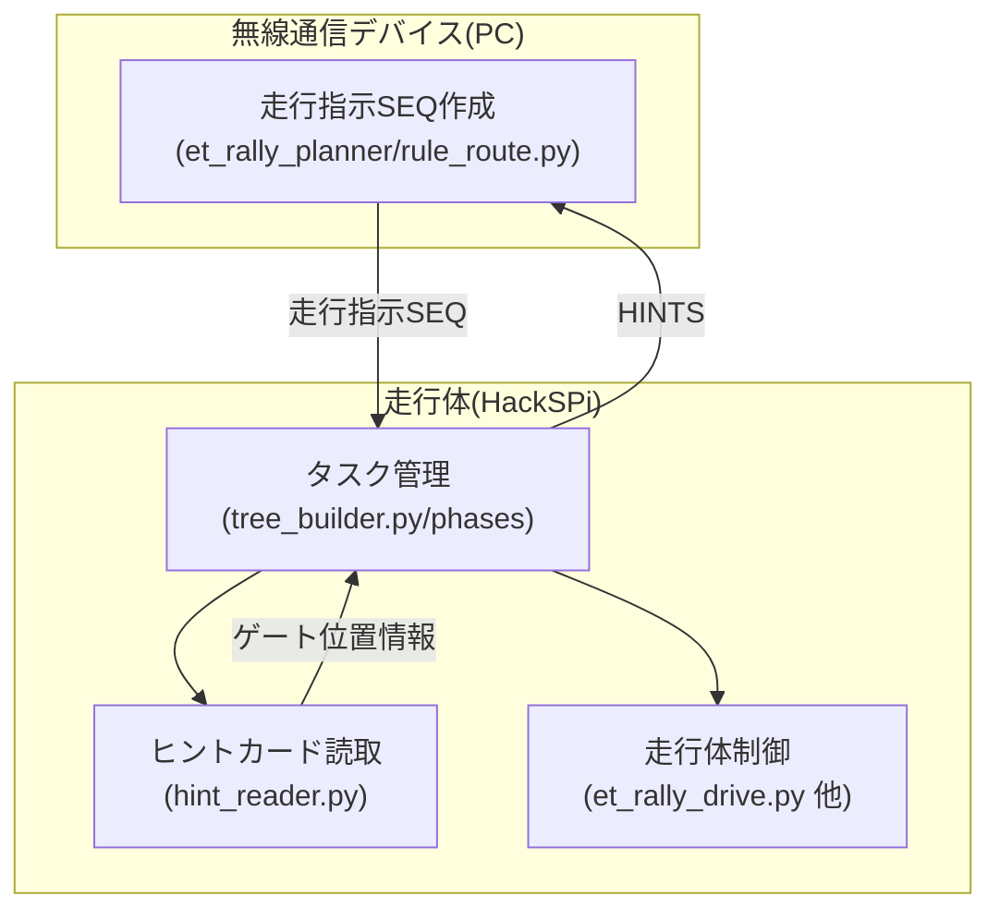
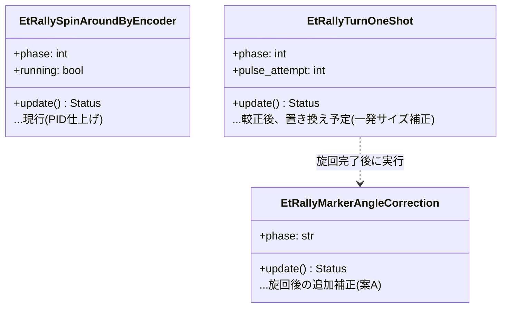
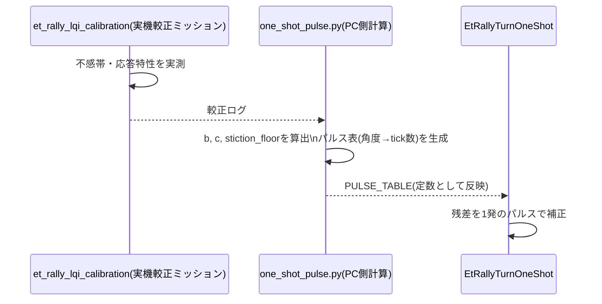

# ETラリー モデル図(4〜6枚目)作成資料 v2(2026-09-29)

v1([ET_RALLY_MODEL_SURVEY_v1.md](ET_RALLY_MODEL_SURVEY_v1.md))は2026-09-26時点のコード調査結果。
本v2は、それ以降にこのセッションで検討・実装した内容(LQI検討→不採用、バックラッシュ診断、
一発サイズ補正、直進の加減速、カメラ角度補正の方針)を反映し、**実際に提出するモデル(4〜6枚目)の
下書き**として書く。

## 0. 本資料の位置づけ(v1との違い)

- v1は「確認済み/未確認/推測」を厳密に分ける**調査資料**だった。
- 本v2は**モデル提出物の下書き**であり、性質が異なる。ユーザー方針: 「これから確実にやるだろうことは
  先に書いてしまう」「1〜3枚目の既存記述との矛盾は無視し、今の会話の方針を正とする」。
  したがって、実機未検証の項目(チェッカーボード較正、LQI/一発補正の実測、等)も、**実現前提の設計**として
  記述する。検証結果の数値だけは、実機テスト後に埋める空欄として明示する。
- 審査対象範囲は「ETラリー」のみ(2026審査規約 p.38)。
- 配点(p.51): 要求20%/システム分析25%/**設計30%**/制御15%/総合10%。設計モデルが最大配点。

既存1〜3枚目(`ＭＳ＆ＡＤモード２Ａ・Ａpdf`)のサブシステム定義(表2-2-1)をそのまま踏襲する:

| サブシステム | 色 | 対応するコード |
|---|---|---|
| タスク管理 | オレンジ | `robot_program/tree_builder.py`, `phases/`, `services/strategy_tree.py` |
| ヒントカード読取 | 緑 | `robot_program/behaviours/hint_reader.py`, `services/strategy_exchange.py`(復号) |
| 走行指示SEQ作成 | ピンク | `wireless_device/et_rally_planner/`(`rule_route.py`等) |
| 走行体制御 | 青 | `robot_program/behaviours/et_rally_drive.py`, `et_rally_compensation.py`, 新設のLQI/一発補正/カメラ補正一式 |

**4〜5枚目で選ぶ「重要な1つの構成要素」は、引き続き「走行体制御」サブシステム内の旋回制御クラスを推薦する**
(v1の5-2節と同じ理由: 実測データが最も濃い、位置精度という最重要品質要求に直結、実在するクラスとして自己完結)。

---

## 1. 新しい設計判断(DD-21〜DD-27、v1のDD表への追加分)

| ID | 課題 | 検討した候補 | 採用案 | 理由・根拠 | 状態 |
|---|---|---|---|---|---|
| DD-21 | 旋回フェーズ2の制御則をどうするか | (a)現行PID (b)LQR/LQI(状態フィードバック) (c)一発サイズのパルス補正 | 検討順は(b)→棄却→(c) | (b)は「角度は既に実測で正確、揺れの原因はゲインでなく不感帯・バックラッシュという機構要因」という分析により、位置ズレにも揺れにも直接効かないと判断し不採用。(c)は揺れの原因(不感帯の粒度)に直接対応する設計として採用方針 | 設計確定、実測待ち |
| DD-22 | 旋回時の揺れ(往復)の原因特定 | (a)ゲインが最適でない (b)不感帯(静止摩擦)の粒度 (c)バックラッシュ(機構の遊び) | (b)(c)の複合と推定 | 走行体を持ち上げてタイヤを手で回すと約1cm軽く動く現象を確認。これは地面との摩擦ではなく、モーター〜タイヤ間の機構内部の遊びと判断。方向転換のたびに遊びを詰め直すことが揺れの一因と推定 | 推定(実機での定量測定は今後) |
| DD-23 | フェーズ2を往復させず1回で収めるには | 一発サイズのパルス補正(較正データからtick数を逆算し、狙った角度だけ動かして止める) | 採用方針 | 不感帯ぎりぎりの出力は角加速度が弱く、大きい残差には遅い可能性がある(試算で5度の補正に約5.6秒)という課題が残るため、残差の大きさに応じて出力を変える設計への拡張も今後検討 | 設計・ツール実装済み、実測待ち |
| DD-24 | 位置ズレ(横方向)の原因切り分け | フェーズ2をほぼ無効化(許容角8度)して同一パターンの旋回を再試行し、通常設定と比較 | 診断ミッションとして実装 | 過去にも同種の切り分け(2026-09-12)を実施した実績があり、同じ考え方をB方向横ズレにも適用 | 実機テスト待ち |
| DD-25 | 直進の加減速 | 区間全体をゆっくり加減速 / 開始直後・終了直前だけ短く加減速 | 後者を採用、本番へ反映済み | 巡航区間の速度を落とさずに、急発進・急停止による影響だけを緩和する狙い | 実装済み(`accel_mm`/`decel_mm`、既定30mm) |
| DD-26 | 旋回後の向き補正(カメラ) | 角度のみ補正(案A) / 横ズレも補正(案B) | 今回は案Aのみ | 位置ズレは旋回そのものの原因対策(DD-21〜24)を優先し、カメラは角度の仕上げとして位置づけ | 検出・非同期組み込みの土台は実装済み、較正は実機待ち |
| DD-27 | カメラの較正方法 | 較正定数(角度オフセット・ゲイン)のみ / チェッカーボードによるレンズ歪み補正を追加 | 追加する方針 | マーカーが画面のどこに映っても角度の測定精度が安定するため。取り付け角度のズレ(オフセット)や視野角のゲインとは独立した、レンズの幾何学的な癖を補正するもの | 方針決定、実機での較正は今後 |

---

## 2. 4枚目: 設計モデル①(全体構成)

既存1〜3枚目の型(タブヘッダー、サブシステム色分け、コンポジット構造図)を踏襲する。

### 2-1. 分析との対応
「走行指示SEQ作成」(ピンク、PC側)と「走行体制御」(青、ラズパイ側)を通信で疎結合にした構成が、
2.4節のトレードオフ分析(表2-4-1、案B採用)をそのまま実現している、という対応を明示する。

### 2-2. 全体構成図(案、Mermaid)

### 2-3. 走行体制御サブシステムの内部候補(選択根拠)

「走行体制御」内部で、クラス相当の詳細度を示す1構成要素として、**旋回制御クラス**を選ぶ。

選択根拠(p.49「なぜそれが重要と考えているか」への回答):
- ETラリーの品質要求(指示どおりの角度・位置で走行し支柱に接触しない)に最も直結する
- 実測データが最も豊富(90度×30回試行、直進較正、キャスター/横ズレ実測)
- PID→LQI検討→一発サイズ補正という**設計判断の変遷そのものが説明できる**、数少ない構成要素

---

## 3. 5枚目: 設計モデル②(走行体制御の詳細)

### 3-1. 対象クラスの構成(現行+今後の発展)

### 3-2. 状態遷移図

v1の5-4節(`EtRallySpinAroundByEncoder`のステートマシン図)をベースに、`EtRallyTurnOneShot`の
状態遷移(フェーズ1→フェーズ2: 一発補正→(必要なら2回目)→完了)を並記する。往復せず、
**最大2回で必ず終わる**(不感帯より細かい残差は追いかけない)という設計上の特徴を明示する。

### 3-3. 較正データの流れ(新規、シーケンス図)

---

## 4. 6枚目: 制御モデル(1テーマに絞る)

KatLabの審査コメント(「2個の制御モデルを紙面の都合で両方薄く書いたことが減点対象になった」)を踏まえ、
**「旋回精度の実現」1本**にテーマを絞る(カメラの角度補正は、このテーマの中の補完技術として位置づける)。

### 4-1. 品質要求(定量目標を先に明示)

- 旋回の角度誤差: フェーズ2完了時点で0.5度以内(既存基準を維持)
- 旋回に伴う位置ズレ: 現状把握中(要実測)、目標は「連続旋回でも数cm以内」
- 揺れ(往復修正)の解消: 一発(最大2回)で収束

### 4-2. 検討した制御戦略の比較(既存の重み付き表スタイルを踏襲)

| 観点 | 重み | 案A: 現行PID | 案B: LQR/LQI(状態フィードバック) | 案C: 一発サイズ補正 |
|---|---|---|---|---|
| 角度精度への効果 | 4 | 〇 実測で既に良好 | 〇 理論上さらに向上可能 | 〇 較正データに基づき狙って収束 |
| 位置ズレへの効果 | 5 | ✕ 効かない(何も測っていないため) | ✕ 効かない(角度制御のため) | ✕ 効かない(同上、別対策(DD-24,26)が必要) |
| 揺れ(往復)の解消 | 5 | ✕ 不感帯・バックラッシュを繰り返し踏む | ✕ 同じ不感帯クランプを持つため解消しない | 〇 最大2回で打ち切る設計 |
| 実装・検証コスト | 2 | - (既存) | △ 実測モデル化が必要、効果は限定的 | 〇 既存の較正手順を流用可能 |
| (総合得点) | | | | **最有力** |

結論: **LQR/LQIは、角度精度・位置ズレ・揺れのいずれに対しても現行PIDに対する優位性が乏しいと判断し不採用**。
「不感帯・バックラッシュという機構要因」に直接対応する**一発サイズ補正**を採用する。

### 4-3. 要素技術①: 不感帯・バックラッシュの診断

- 不感帯: 較正ミッション(`FindStictionThreshold`)で、方向ごとの最小駆動パワーを実測
- バックラッシュ: 走行体を持ち上げてタイヤを手で回し、遊びの有無を確認(機構内部の遊びであり、
  地面との摩擦=不感帯とは別要因)。往復のたびにこの遊びを踏み直すことが、揺れの一因と推定

### 4-4. 要素技術②: 一発サイズのパルス補正

- モデル(離散時間): `omega[k+1] = omega[k] + (b*u_eff - c*omega[k])*dt`
- 較正データ(b, c, 不感帯の下限パワー)から、目標角度ごとに必要なtick数を事前計算(パルス表)
- 実行時は、残差に最も近いtick数のパルスを1回与えて止める。収まらなければ最大1回だけ再試行

### 4-5. 要素技術③: カメラによる角度補正(補完技術)

- グレー円に囲まれた座標プリントを、QRとしてデコードせず物体として検出し、上辺の傾きから角度誤差を推定
- **チェッカーボードによるレンズ歪み補正**を追加較正することで、マーカーが画面のどこに映っても
  角度の測定精度が安定するようにする(取り付け角度のオフセット・視野角のゲインとは独立した改善)
- 旋回完了直後の「間」に処理を重ね、新たな停止時間を作らない設計(`PrepareEtRallyMarkerCamera`による事前準備)

### 4-6. 検証方法(実機テスト後に数値を埋める、空欄のまま提出資料に含めておく)

| 試験 | 条件 | 回数 | 指標 | 結果 |
|---|---|---|---|---|
| 一発サイズ補正の角度精度 | 較正後、小角度(1〜5度)の残差補正 | (実測予定) | 収束後の誤差(度) | *要実測* |
| 一発サイズ補正の所要時間 | 同上 | (実測予定) | 収束までの時間(秒) | *要実測*(大きい残差で遅くなる懸念、DD-23) |
| フェーズ2切り分け(DD-24) | 通常設定 vs フェーズ2ほぼ無効化 | 各30回程度(既存パターン踏襲) | 横ズレ(cm) | *要実測* |
| カメラ角度補正の精度 | チェッカーボード較正後 | (実測予定) | 補正前後の角度誤差(度) | *要実測* |

---

## 5. 要求モデルとの対応(追跡表への追加分)

| 要求(仮ID、既存要求IDに合わせて命名すること) | 対応する設計・制御 |
|---|---|
| CTR-旋回精度 | DD-21〜23(一発サイズ補正)、6枚目4-2〜4-4 |
| CTR-位置ズレ低減 | DD-24(切り分け診断)、6枚目4-1 |
| CTR-画像認識の活用 | DD-26,27(カメラ角度補正)、6枚目4-5 |

---

## 6. 未解決・今後埋めるべき空欄

- 6枚目4-6の検証結果表(実機テスト後に記入)
- DD-24(位置ズレ原因)の実測結果、原因が特定できた場合はDD表・6枚目本文の更新
- 1〜3枚目(要求・分析)の「赤色ゲート基準の周回ごと補正」という記述との整合(今回は無視する方針だが、
  最終提出前に1〜3枚目側を更新するかどうかは別途判断すること)

*本資料はモデル下書きの土台であり、そのまま提出用スライド/シートへの流し込みを想定する。実機テストの結果は、
得られ次第この資料および提出モデルへ反映すること。*
